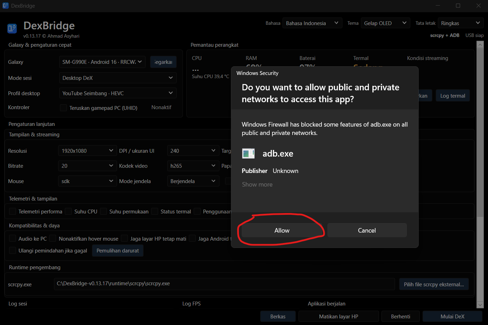
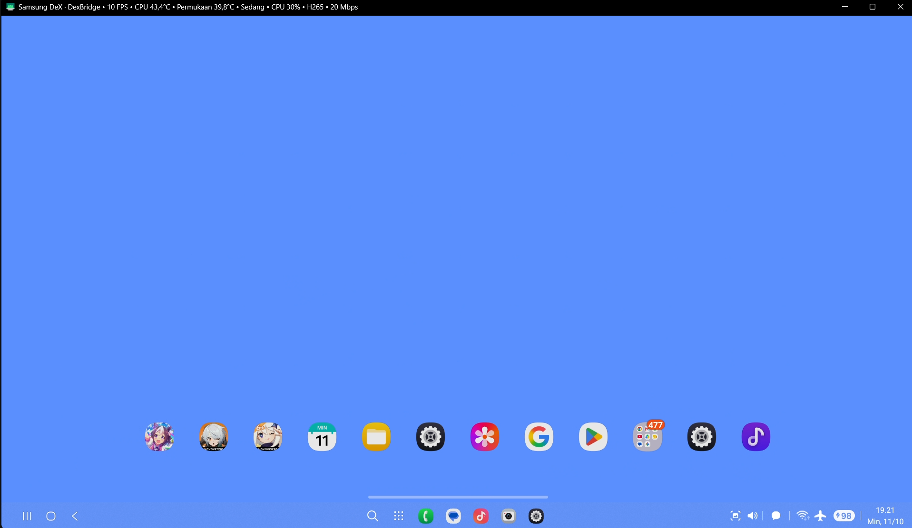
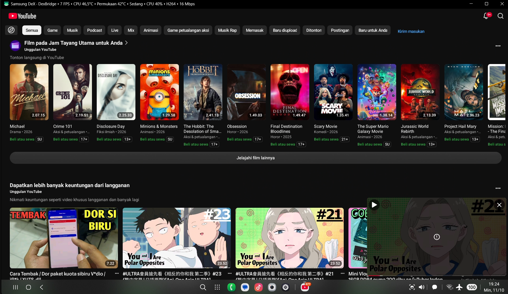
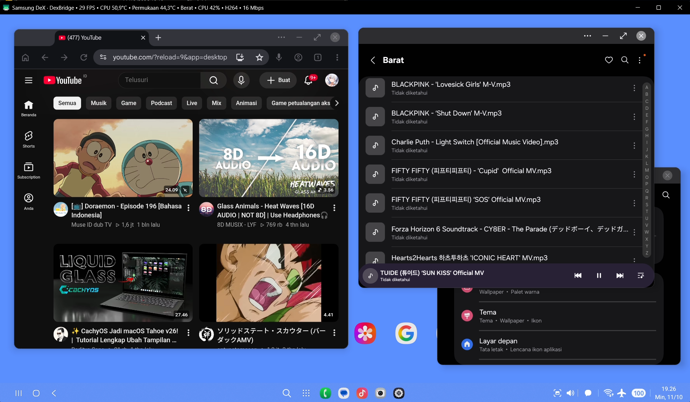

# DexBridge

<p>
  
  
  
  
</p>

**DexBridge** adalah aplikasi desktop Windows untuk perangkat Samsung Galaxy yang menyediakan fitur streaming Samsung DeX, mirroring layar ponsel, dan streaming aplikasi melalui USB dengan menggunakan scrcpy dan ADB.

Rilis ini menghadirkan aplikasi Windows portabel yang sudah menyertakan scrcpy dan ADB di dalamnya.

## Fitur

- **Samsung DeX:** Streaming lingkungan desktop dari perangkat Samsung Galaxy yang kompatibel ke Windows.
- **Mirroring Layar Ponsel:** Menampilkan dan mengontrol layar ponsel secara langsung dari PC Anda.
- **Streaming Aplikasi & Game:** Menjalankan aplikasi Android dengan profil tampilan dan streaming yang dapat dikonfigurasi.
- **Pemantauan Performa:** Memantau FPS, penggunaan CPU, suhu perangkat, dan status termal.
- **Streaming yang Dapat Disesuaikan:** Mengatur resolusi, DPI, bitrate, FPS, dan codec H.264/H.265.
- **Dukungan Input:** Penerusan input keyboard, mouse, dan gamepad yang didukung.
- **Manajemen File:** Mentransfer file antara PC dan perangkat Android Anda.
- **Tema:** Terang (Light), Gelap (Dark), dan OLED Dark.
- **Bahasa:** Bahasa Indonesia dan Bahasa Inggris.
- **Pengaturan Tersimpan:** Memulihkan preferensi aplikasi antar sesi penggunaan.

## Unduhan dan Instalasi

Unduh **`DexBridge-v0.13.17-win64.zip`** yang ada pada bagian relase.

1. Ekstrak file ZIP ke sebuah folder.
2. Pastikan semua file dan folder yang disertakan tetap berada dalam satu lokasi yang sama.
3. Jalankan **`DexBridge.exe`**.
4. Hubungkan perangkat Samsung Galaxy yang kompatibel melalui USB.
5. Aktifkan *USB debugging* dan berikan izin akses (*authorize*) untuk PC Anda.
6. Pilih mode streaming dan mulai sesi Anda. **Tidak diperlukan instalasi terpisah untuk .NET, scrcpy, atau ADB.**

## Persyaratan Sistem

- Windows 10 atau Windows 11 (64-bit)
- Perangkat Samsung Galaxy dengan fitur *USB debugging* yang aktif
- Kabel data USB
- Dukungan Samsung DeX pada perangkat yang terhubung untuk mode desktop DeX

## Komponen yang Disertakan

- DexBridge v0.13.17
- scrcpy 5.0
- Android Debug Bridge (ADB)
- Dependensi *runtime* yang diperlukan

Perangkat lunak pihak ketiga tetap tunduk pada lisensi masing-masing. Lihat pemberitahuan lisensi yang disertakan untuk rincian lebih lanjut.

## Untuk Pengembang

Kode sumber dan dokumentasi *build* tersedia di repositori ini.

Untuk menjalankan dalam mode pengembangan:

```powershell
dotnet run --project DexBridge.csproj -c Debug
```

Untuk membuat aplikasi Windows portabel:

```powershell
powershell -NoProfile -ExecutionPolicy Bypass -File .\tools\Build-Portable.ps1
```

Proses *build* dari kode sumber memerlukan .NET 10 SDK.

## Catatan

- Ini adalah aplikasi portabel, bukan *installer* Windows.
- Pastikan direktori `runtime/scrcpy` yang disertakan tetap berada di lokasi yang sama dengan `DexBridge.exe`.
- Kompatibilitas perangkat dan performa *streaming* dapat bervariasi tergantung pada model Samsung Galaxy dan versi Android Anda.

---

### Troubleshooting build portable: scrcpy/ADB tidak tersalin

Untuk troubleshooting, verifikasi hasil build, dan langkah unggah ke GitHub, baca **[Panduan Developer: Build Lokal Windows](docs/PANDUAN-DEVELOPER-LOKAL.md)** dan [Panduan Build & Rilis](docs/BUILD-DAN-RILIS.md).

Jika `dotnet publish` sudah berhasil tetapi pesan `bundled scrcpy/ADB runtime was not copied` muncul, masalah ada pada pengemasan runtime, bukan kompilasi C#. Gunakan `tools/Build-Portable.ps1` versi hotfix ini: skrip akan menyalin seluruh `runtime/scrcpy` secara eksplisit ke folder distribusi. Panduan dan pemulihan tanpa rebuild: [docs/BUILD-HOTFIX-RUNTIME.md](docs/BUILD-HOTFIX-RUNTIME.md).

## Dokumen

- [Panduan developer: menjalankan source, build EXE di laptop, dan troubleshooting](docs/PANDUAN-DEVELOPER-LOKAL.md)
- [Pengembangan dan penerbitan GitHub](docs/BUILD-DAN-RILIS.md)
- [Cara menggunakan bagi pengguna Windows](docs/PANDUAN-PENGGUNA.md)
- [Informasi lisensi source dan komponen pihak ketiga](docs/LISENSI-DAN-ATRIBUSI.md)
- [Riwayat pengembangan](docs/RIWAYAT-PENGEMBANGAN.md)
- [Catatan versi](RELEASE-NOTES.md)

## Keamanan dan keterbatasan

- Gunakan **hanya pada ponsel milik sendiri/yang memberi izin**. USB debugging memberikan akses kuat pada perangkat dan harus dipercaya secara sadar.
- `Stream FPS` adalah FPS frame yang terkirim/ditampilkan oleh scrcpy, **bukan** pengukuran FPS engine game.
- UI aplikasi Android (termasuk YouTube) mengikuti aturan Android dan DPI/resolusi yang dipilih; tidak semua layout dapat dipaksakan.
- Build tanpa penandatanganan kode dapat menampilkan peringatan Windows SmartScreen.
- Sebagian fitur terkait Samsung DeX, Android 16, dan shell ADB dapat berbeda tergantung firmware Galaxy.

DexBridge bukan produk resmi Samsung, Google, maupun Genymobile. ini hanyalah project standalone, hanya sekedar meluangkan hobi.
© Ahmad Asyhari
